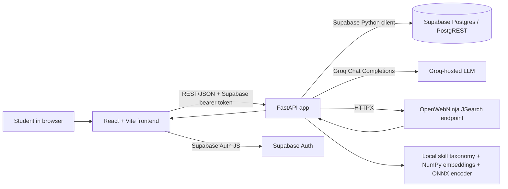

# SkillSetu Project Audit

## Scope and evidence

This report is based on the checked-in source, configuration, SQL, tests, and documentation in this workspace. The local `.env` files were not read for values; only variable names are listed. No live Supabase, Groq, or job-source request was made, and no hosted database migration was verified. Statements about those integrations describe code paths, not a successful production deployment.

## 1. PROJECT OVERVIEW

### Problem and intended users

SkillSetu is intended to help students turn resume/profile information into job recommendations and skill-gap learning plans. It also exposes a campus placement-demand screen. The project is a React frontend and a Python API; it is not an employer hiring or application-processing platform.

### Features present in code

- **Resume profile extraction:** an authenticated user uploads a PDF; PyMuPDF extracts text and a Groq model returns a Pydantic-validated profile with skills and projects.
- **Manual and multiple profiles:** users can submit a manual profile, list saved profiles, and switch the active profile. Profile and skill data are written to Supabase.
- **Job ingestion:** a JSearch endpoint supplied by OpenWebNinja is fetched; new or changed listings are normalized and their skills/eligibility are extracted by Groq.
- **Job recommendations:** a deterministic backend matcher compares normalized student and job skills, applies location/job-type/remote filters, calculates a score, and returns matched and missing skills and an application URL. The formula is 80% required-skill coverage plus up to 10% location and 10% job-type preference, proportionally normalized over active dimensions; current version is `coverage-location-type-v3`.
- **Skill framework:** a local taxonomy supports search, alias/vector normalization, related-skill lookup, and context retrieval for LLM prompts.
- **Conversational filter updates:** a Groq call turns chat text into structured preferences; the API saves them and reruns matching. Not all extracted preferences affect matching (see the problem list).
- **Learning roadmaps:** the current roadmap builder derives target-job gaps from recommendations, adds framework prerequisites, and identifies gaps repeated across top matches. Students can save progress and submit evidence; evidence is not verified automatically.
- **Planner/executor endpoint:** Groq proposes a sequence from a fixed set of capabilities; Python dispatches those steps sequentially.
- **Campus placement screen:** present but explicitly mock data, not institutional analytics.

“Present in code” does not mean “confirmed against live provider accounts.” Supabase, Groq, and OpenWebNinja integrations were not live-tested in this audit.

### Mocked, partial, or unverified

- The institutional demand endpoint returns hard-coded sample counts, roles, skills, growth, and recommendations; the response marks itself `is_mock`.
- The Applications screen and Skill Analysis screen contain hard-coded example records and numbers. They do not read application tracking or profile skill assessments from the backend.
- Empty/success “state previews” are static UI. The legacy `frontend/src/pages/Roadmap.jsx` is also static; the active navigation uses the API-backed roadmap component instead.
- Automatic job ingestion requires provider configuration and a working database. The hosted source, credentials, rate limits, SQL setup, and scheduled job were not verified.
- The new learning-progress API requires the `student_learning_progress` migration to be applied to the target Supabase database. The migration is in the repo; deployment status is **NOT VERIFIED**.
- Resume extraction accuracy, job-requirement extraction accuracy, match quality against real outcomes, and roadmap usefulness have no measured benchmark in the repo.
- Monitoring and production deployment are marked as pending in `docs/PROJECT_PROGRESS_LOG.md`; corresponding production configuration is **NOT FOUND**.

## 2. ARCHITECTURE

### High-level architecture



### Request/data flow

1. The frontend authenticates with Supabase JS. For protected backend routes it retrieves the access token and sends it as a bearer token.
2. The API validates the token using Supabase Auth and creates a Supabase client with the user's token for database operations.
3. Resume upload reads a PDF, extracts text with PyMuPDF, retrieves skill-framework context locally, asks Groq for structured profile output, validates it, then writes profile/skill/project and resume records.
4. Job sync fetches listings from OpenWebNinja's JSearch endpoint, cleans and hashes listing content, calls Groq for requirements when a listing is new or changed, then writes jobs, skills, and job-skill relations to Supabase.
5. Recommendation requests read the authenticated user's skills and a bounded set of active jobs/requirements. Python normalizes skills, filters and scores the candidates, retrieves related gap skills locally, and attempts to persist the matches.
6. Roadmap requests reuse recommendations and the local framework to build deterministic roadmaps. Progress/evidence updates go to a separate Supabase table.
7. Chat and planner/executor requests call Groq for preference or plan JSON, then use ordinary Python functions and Supabase queries for execution.

### Components and communication

- `backend/app/main.py` owns the API routes, authentication dependency, CORS configuration, scheduler lifecycle, and endpoint wiring. The `backend/app/routes/` directory is empty; routes are not split into modules.
- `backend/app/agents/` contains resume profiling, job requirement extraction, chat preference parsing, planning, and execution.
- `backend/app/services/` contains resume parsing, matching, skill-framework retrieval, persistence, synchronization, and roadmap logic.
- `backend/app/schemas/` contains Pydantic request/response models.
- `backend/app/sources/jsearch.py` calls the external job source over HTTPX.
- `backend/sql/` contains manual PostgreSQL/Supabase migrations; no migration runner is configured.
- The frontend calls the API with Axios and Supabase JS. Agent orchestration is a custom Python plan plus sequential dispatch, not LangChain, LangGraph, a queue, or a workflow service.
- The scheduled sync uses APScheduler. No message queue or distributed cache is present. In-memory fallback caches are Python dictionaries local to one process.

### API routes found in `backend/app/main.py`

`GET /`, `GET /db-test`, `GET /api/skill-framework/search`, `/normalize`, `/gaps`, `GET /api/institution/skills`, `POST /api/resume/analyze`, `GET /api/resumes`, `POST /api/resumes/manual`, `POST /api/resumes/{resume_id}/activate`, `POST /api/opportunities/sync`, `/sync-local`, `GET /api/opportunities/recommended`, `/recommended-local`, `/saved`, `GET /api/learning-roadmap`, `PUT /api/learning-progress`, `POST /api/chat`, `/chat-local`, `POST /api/agent/run`, and `/run-local`.

The root README and frontend API helper refer to `GET /health`; that route is **NOT FOUND** in the backend route definitions.

## 3. FOLDER STRUCTURE

```text
SkillSetu/
├── README.md                         # Backend quick-start; incomplete for a clean full-stack setup
├── .gitignore                        # Root ignores environment files, local DB files, and editor files
├── .vscode/                          # Workspace/editor settings
├── backend/
│   ├── requirements.txt              # Python dependency ranges
│   ├── .env.example                  # Backend environment variable names and placeholders
│   ├── app/
│   │   ├── main.py                   # FastAPI routes, auth, CORS, scheduler, service wiring
│   │   ├── config.py                 # Pydantic settings; job-source settings are used
│   │   ├── database.py               # Supabase clients and auth/service client helpers
│   │   ├── agents/                   # LLM profile/job extraction, chat, planner, executor
│   │   ├── schemas/                  # Pydantic models for API and agent data
│   │   ├── services/                 # Matching, RAG, parsing, persistence, sync, roadmap
│   │   ├── sources/jsearch.py        # OpenWebNinja JSearch HTTP adapter
│   │   ├── routes/                   # Empty; API routes currently live in main.py
│   │   └── data/
│   │       ├── skill_framework.json  # 232-record local taxonomy
│   │       ├── skill_embeddings.npy  # 232 x 384 float32 embedding matrix
│   │       ├── skill_metadata.json   # Metadata matching framework records
│   │       ├── generate_framework.py # Taxonomy generation source
│   │       ├── precompute_embeddings.py # Offline ONNX embedding generator
│   │       └── models/all-MiniLM-L6-v2/ # Bundled tokenizer and ONNX model (~90 MB)
│   ├── sql/                          # Manual migrations for candidate state, resumes, RLS, etc.
│   ├── test_data/resumes/            # Three sample PDF resumes
│   ├── test_*.py                     # Unit tests and standalone verification scripts
│   └── verify_db.py                  # Manual live Supabase table sampler
├── frontend/
│   ├── package.json                  # React/Vite dependencies and scripts
│   ├── package-lock.json             # npm lockfile
│   ├── vite.config.js                # Vite React plugin
│   ├── index.html                    # SPA shell
│   └── src/
│       ├── App.jsx                   # Authentication state, navigation, active screens
│       ├── components/               # Main screens, auth/onboarding, profile, roadmap, UI
│       ├── pages/                    # Older/alternate screens; some are not mounted by App.jsx
│       ├── services/                 # Axios API, Supabase auth, resume and opportunity calls
│       ├── styles/                   # Main screen and theme styles
│       └── assets/                   # Static image and starter assets
├── docs/                             # Architecture, RAG, matching, fairness, and progress notes
└── mistakes&imporvements/            # Opportunity-agent troubleshooting notes
```

The base schema for core tables such as `profiles`, `skills`, `student_skills`, `projects`, and `jobs` is **NOT FOUND** among the SQL files in this repo. Some migrations alter or rely on those tables being created elsewhere.

## 4. TECH STACK

Versions below are those declared in dependency manifests, not a claim that every clean install was reproduced.

| Area | Actual code/config |
|---|---|
| Backend language | Python; sample/runtime validation here used Python 3.11 |
| Backend API | FastAPI `>=0.115,<1.0`; Uvicorn `>=0.30,<1.0` |
| Backend models/config | Pydantic Settings `>=2.6,<3.0`; Pydantic models are used for validation |
| Database access | Supabase Python SDK `>=2.0,<3.0`; SQL files use PostgreSQL/Supabase syntax |
| Resume extraction | PyMuPDF `>=1.24,<2.0`; no OCR implementation found |
| LLM SDK | Groq `>=0.11,<1.0`; Chat Completions calls with JSON response mode |
| External HTTP | HTTPX `>=0.27,<1.0`, Certifi `>=2024.2.2` |
| Scheduler | APScheduler `>=3.10,<4.0` |
| Frontend | React `^19.3.1`, React DOM `^19.3.1`, React Router DOM `^7.18.5`, Vite `^8.3.6` |
| Frontend libraries | Supabase JS `^2.119.0`, Axios `^1.21.0`, lucide-react `^1.70.0`, Recharts `^3.10.1`, Tailwind CSS/Vite plugin `^4.3.5` |
| Frontend lint | Oxlint `^1.90.0`; no TypeScript source was found |
| Local embeddings | `all-MiniLM-L6-v2` in ONNX form, tokenizer files, NumPy dot products; model files are bundled under `backend/app/data/models/` |
| Databases/vector stores/caches | Supabase Postgres is used through its SDK. A standalone vector database is **NOT FOUND**. The vector matrix is loaded into process memory. SQLite/SQLAlchemy are mentioned in config/docs/manifests, but the application code does not use a SQLAlchemy engine or SQLite connection. |
| Deployment | Hosting/deployment manifests are **NOT FOUND**. `docs/PROJECT_PROGRESS_LOG.md` lists deployment as pending. |

Dependency caveat: `skill_framework_rag.py` imports NumPy at module import time, and the RAG code conditionally imports `onnxruntime` and `tokenizers`, but those packages are not declared in `backend/requirements.txt`. A clean backend install from that file is therefore not a complete declaration of the runtime needed for the RAG path; whether NumPy arrives transitively is not a supported dependency contract.

## 5. AGENTS, TOOLS & PIPELINES

### Agent-like modules and deterministic tools

| Name | Purpose, input, and output |
|---|---|
| `analyze_resume` in `backend/app/agents/skill_profiling.py` | Input: extracted resume text. Adds framework context, calls Groq, normalizes profile JSON, validates as `StudentProfile`. Output: structured profile, skills, and projects. Skill confidence/proficiency are model estimates, not calibrated measurements. |
| `extract_opportunity_requirements` in `backend/app/agents/opportunity_agent.py` | Input: normalized `RawOpportunity`. Adds retrieved framework context and asks Groq for listing-supported skills/eligibility. Output: validated `ExtractedOpportunity`. |
| `parse_conversational_preference` in `backend/app/agents/chat_agent.py` | Input: chat text and current preferences. Calls Groq to produce a `PreferenceUpdate`, then canonicalizes extracted skills. Output: preference delta and assistant text. |
| `generate_agent_plan` in `backend/app/agents/planner.py` | Input: goal and context. Calls Groq for a structured plan restricted by `PlanStep` to `profile`, `retrieve`, `match`, and `roadmap`. Empty plans fall back to a fixed four-step plan. |
| `AgentState`, `STEP_DISPATCH`, `execute_plan` in `backend/app/agents/executor.py` | Input: plan, student state, optional Supabase client. Sequentially dispatches steps to Python functions and records a trace. It does not use an agent framework. |
| `call_llm_with_validation` in `backend/app/services/llm_validator.py` | Calls Groq Chat Completions using JSON response mode, parses JSON, optionally normalizes it, validates with Pydantic, and retries once by default after JSON/schema validation errors. It does not retry provider/network exceptions or validate factual correctness. |
| `extract_resume_text` in `backend/app/services/resume_parser.py` | Extracts text from a PDF using PyMuPDF. Empty/scanned PDFs fail; OCR is not present. |
| `sync_opportunities` and `fetch_jsearch_jobs` | Fetches source listings and persists new/changed normalized records; the adapter is specifically OpenWebNinja's JSearch route. |
| `recommend_opportunities` in `backend/app/services/opportunity_matching.py` | Deterministic skill set matching, filtering, scoring, ranking, gap retrieval, and persistence attempt. |
| `build_learning_roadmaps` in `backend/app/services/learning_roadmap.py` | Deterministically builds target-job and repeated-gap roadmaps from recommendation gaps and framework prerequisites. It does not call an LLM. |

### Prompt locations

There is no prompt directory or separate prompt registry. Prompt text is embedded in:

- `backend/app/agents/skill_profiling.py` — resume/profile extraction and evidence constraints.
- `backend/app/agents/opportunity_agent.py` — job requirement and eligibility extraction.
- `backend/app/agents/chat_agent.py` — preference extraction and reply generation.
- `backend/app/agents/planner.py` — allowed capability planning.
- `backend/app/services/llm_validator.py` — correction feedback appended after invalid JSON/schema output.

### Retrieval/RAG setup

- Corpus: `backend/app/data/skill_framework.json` declares 232 documents: 8 roles and 224 skill records.
- Embeddings: `backend/app/data/skill_embeddings.npy`, shape `(232, 384)`, loaded into memory. The ONNX model/tokenizer encode a query; the engine compares it to the matrix with a dot product.
- Text representation for offline embeddings includes title, category, aliases, description, related skills, and prerequisites. Each taxonomy record is one retrieval unit; a separate text chunking pipeline is **NOT FOUND**.
- Search combines vector similarity and exact/partial lexical boosts. Alias lookup precedes vector normalization; vector normalization uses a threshold of `0.58`; unknown inputs fall back to the original string.
- Related-skill lookup returns taxonomy prerequisites and related skills. Prompt context is formatted and inserted into Groq prompts.
- No external vector database, learned reranker, or retrieval benchmark is present. `skill_metadata.json` is loaded into engine metadata but is not used in the shown search path.
- The standalone RAG script passed when run with UTF-8 output (`python -X utf8 test_rag.py` from `backend`). It reported about 35 ms average search latency on this machine; this is a local run, not a general performance guarantee. The plain Windows console run failed while printing the microsecond symbol due to CP1252 output encoding.

## 6. EXTERNAL APIs & RESOURCES

| Service/resource | Use in code | Cost/limits |
|---|---|---|
| Supabase Auth and Postgres/PostgREST | User auth, profile/jobs/matches/progress persistence; authenticated and service clients are created in `backend/app/database.py`. | Account plan, quotas, and production configuration are **NOT FOUND** in code. |
| Groq API | Profile extraction, job requirement extraction, preference parsing, and planner JSON generation via Groq Chat Completions. Default model is `llama-3.3-70b-versatile`, overridable by configuration. | Provider pricing and rate limits are **NOT FOUND** in repo and depend on provider/account configuration. |
| OpenWebNinja JSearch API | Job/internship search at `/jsearch/search-v2`, configured through the source adapter. | Provider plan, pricing, quotas, and response SLAs are **NOT FOUND** in repo. |
| Local `all-MiniLM-L6-v2` ONNX model | Query embeddings for skill framework search and normalization. Model/tokenizer assets are bundled locally; no runtime model-hosting call is made by this path. | External download/provenance/license details are **NOT FOUND** in the application configuration. |
| Curated skill taxonomy | Repository JSON data used for normalization, retrieval, prerequisites, and prompt grounding. A source attribution beyond the in-repo “curated” label is **NOT FOUND**. |
| Sample PDFs | Three local test fixtures in `backend/test_data/resumes/`; they are not an external live dataset. | Not applicable. |

### Environment variable names (values intentionally omitted)

Backend names listed in `backend/.env.example`: `APP_NAME`, `APP_VERSION`, `DATABASE_URL`, `DEBUG`, `SUPABASE_URL`, `SUPABASE_ANON_KEY`, `SUPABASE_SERVICE_ROLE_KEY`, `GROQ_API_KEY`, `GROQ_MODEL`, `OPENWEBNINJA_API_KEY`, `OPENWEBNINJA_API_HOST`, `JSEARCH_COUNTRY`, `JSEARCH_QUERY`, `JSEARCH_NUM_PAGES`, `OPPORTUNITY_SYNC_ENABLED`, `OPPORTUNITY_SYNC_DEV_MODE`, `OPPORTUNITY_SYNC_INTERVAL_HOURS`, `MATCHING_TEST_STUDENT_ID`.

Backend source also supports `SUPABASE_SECRET_KEY` as the preferred alternative to `SUPABASE_ANON_KEY`. The frontend source reads `VITE_API_URL`, `VITE_SUPABASE_URL`, and `VITE_SUPABASE_ANON_KEY`; a frontend `.env.example` is **NOT FOUND**. `DATABASE_URL`, `APP_NAME`, `APP_VERSION`, and `DEBUG` are declared in settings/example configuration but are not used by the current API/database implementation.

## 7. DATA

- **Student inputs:** PDF resumes (endpoint checks a 5 MiB limit after reading the whole upload into memory), manually submitted profile JSON, and chat text. The application stores extracted profile fields, skill rows, projects, resume metadata/parsed profile, preferences, match records, and optional progress evidence in Supabase. Raw PDF file storage is **NOT FOUND**; the `raw_text` column in the resume migration is not populated by the shown save path.
- **Job inputs:** JSearch records. The adapter skips records without title, description, or application URL. Normalization strips HTML-like tags, whitespace-normalizes text, infers job type/remote markers, and hashes the normalized content. Changed listings are passed to Groq for skill/eligibility extraction.
- **Skill taxonomy:** In-repo JSON with 232 records; its source says curated. The generator script is in `backend/app/data/generate_framework.py`. No external sync/update mechanism or source citations are present.
- **Embedding data:** A 232-by-384 matrix and corresponding metadata JSON are stored in the repository. The precompute script loads local ONNX/tokenizer assets and writes these files. Runtime loads the matrix into memory.
- **Institutional analytics:** hard-coded values in the API, not sourced from campus or employer data.
- **Cleaning/update behavior:** jobs are upserted by source/external ID; content hashes avoid repeated requirement extraction; listings not seen in a sync can be marked inactive. Project insertion does not delete older project rows when a profile is reanalyzed.
- **Data retention, user deletion/export, consent policy, and a production privacy/retention schedule:** **NOT FOUND**.

## 8. HOW TO RUN

### Backend instructions in root README

The root `README.md` gives:

```powershell
cd backend
python -m venv .venv
.\.venv\Scripts\Activate.ps1
pip install -r requirements.txt
uvicorn app.main:app --reload
```

The command sequence is only a partial clean setup. `backend/app/database.py` raises at import time unless `SUPABASE_URL` and either `SUPABASE_SECRET_KEY` or `SUPABASE_ANON_KEY` are configured. LLM-dependent features also need `GROQ_API_KEY`; sync needs OpenWebNinja configuration and the appropriate database access. The README does not instruct users to copy/configure `.env.example`, apply SQL migrations, or install frontend dependencies. `DATABASE_URL` does not provide a fallback application database.

The README says `/health` is available; backend `/health` is **NOT FOUND**. `GET /` is the simple API message route; `/db-test` performs a Supabase query.

### Frontend

The frontend package has `dev`, `build`, `lint`, and `preview` scripts. A typical local frontend setup is `npm install` in `frontend`, configure `VITE_API_URL`, `VITE_SUPABASE_URL`, and `VITE_SUPABASE_ANON_KEY`, then `npm run dev`. These values are read by source, but a frontend `.env.example` and complete frontend run guide are **NOT FOUND**; the frontend README is still the generic React/Vite starter README.

### Verification in this audit

- Backend: `python -m unittest discover -s . -p 'test_*.py'` from `backend` — **24 tests passed**. Running the same discovery from repository root found zero tests.
- RAG: `python -X utf8 test_rag.py` from `backend` — **passed** all script assertions. Plain invocation failed only when the Windows CP1252 console tried to print `µ`.
- Frontend: `npm --prefix frontend run build` — **passed**; Vite reported a minified JavaScript chunk of about 590 kB, above its 500 kB warning threshold.
- No live provider/database integration was run. The standalone Groq-dependent conversational and planner scripts were not run during this audit.

## 9. TESTING & EVALUATION

- `backend/test_opportunity_matching.py` tests deterministic matching, filters, empty skills, valid URLs, scoring, profile skill replacement, and stale match invalidation with fake Supabase queries.
- `backend/test_recommendation_api.py` tests authentication and that a request cannot select another student ID.
- Learning-roadmap/progress tests cover prerequisite ordering, shared gaps, progress validation/upsert, authenticated student IDs, and missing evidence.
- The current unittest discovery run executed 24 tests successfully. These tests are predominantly unit/API tests with mocks; they do not prove hosted Supabase schema/policies or external provider behavior.
- `backend/test_rag.py` is a standalone assertion/latency script, not a quality evaluation set. It checks a small number of expected aliases and that expected records appear within a small result list. It does not calculate recall/precision or compare against expert labels.
- `backend/test_conversational_refinement.py` and `backend/test_planner_executor.py` are standalone scripts that call Groq and therefore depend on an external key/network. `backend/test_fairness.py` is also a standalone script and writes `docs/fairness_report.md`.
- The fairness script uses three synthetic candidates with identical skill lists and hand-authored jobs; it re-implements the score formula rather than testing the entire production recommendation path. The resulting report's claims of EEOC/EU compliance and verified fairness are not supported by this limited test.
- **NOT FOUND:** resume extraction accuracy metrics, labeled job-requirement extraction evaluation, ranking quality metrics (e.g. relevance judgments), user-outcome studies, latency/load tests for the full API, security test suite, or CI pipeline.

## 10. HONEST PROBLEM LIST

### Correctness and product behavior

- Matching ignores job-skill `importance` even though extraction stores it. It also does not evaluate extracted eligibility fields such as degree, graduation year, or work authorization.
- Chat can save `preferred_skills` and `target_role`, but `recommend_opportunities()` receives only location, job type, remote, minimum score, and limit. Those two preference fields therefore do not affect results.
- Matching reads at most 500 active jobs and 5,000 job-skill rows without pagination or an explicit database sort before truncation. Results can omit relevant records in a larger database.
- Location preference is implemented as a substring hard filter; unknown locations are excluded when a location is supplied. This is less nuanced than the matching design document's stated treatment of unknown locations.
- Resume skill confidence and proficiency are model estimates without calibration or evidence-quality checks. No evaluation shows how often they are correct.
- The planner endpoint passes `has_profile: False` to the planner every time, even when persisted profile data may exist. Its executor still loads stored skills in the profile step.
- Executor step functions can catch/log internal database errors and return normally; the executor can then record success. The endpoint builds `success=True` even when trace entries may be failed, so success does not guarantee all requested work completed.
- Frontend top-bar search state is not passed to the opportunity list. Job filters are client-side labels over the loaded recommendation list, not a new server search.
- The Applications screen uses seven hard-coded sample applications; its sidebar badge is hard-coded. Skill Analysis uses hard-coded skill levels and a hard-coded 76% score. These are demo visuals, not student analytics.
- The Career Assistant UI catches a failed chat request and displays a success-shaped “filtered opportunities” message. The service also falls back to `/api/chat-local`, which is not an authenticated user-specific production flow.
- Old page modules remain alongside the current consolidated components; `frontend/src/pages/Roadmap.jsx` is a hard-coded legacy page and is not the active roadmap screen.

### Security, privacy, and input handling

- `/api/chat-local` and `/api/agent/run-local` have no authentication dependency and no localhost/dev-mode guard in their route implementations. They use the service client and a configured/default test student ID. They should not be exposed in a deployed server.
- `/db-test` is unauthenticated and returns sample database rows from `skills`; it should not be exposed as a public production diagnostic.
- `opportunity_rls.sql` gives all authenticated users broad insert/update policies on `jobs` and `job_skills`; the file itself labels these as development policies. Production write access should be restricted to a controlled ingestion role.
- Resume upload trusts the declared content type, reads the entire file before enforcing the 5 MiB limit, has no OCR or malware scan, and sends extracted resume content to an external LLM. No explicit consent, retention, or deletion workflow is present.
- API exception handlers often return `str(error)` to clients. Error text may disclose upstream/database implementation details.
- There is no visible rate limiting for LLM, chat, resume, or sync requests, and planner request fields have no explicit length limits.
- Hosted Supabase RLS/migration state was not verified. Core table creation DDL is missing from this repository's SQL folder.

### Reliability, performance, and maintenance

- LLM calls use the synchronous Groq client, including from async routes and the async sync pipeline. They can block the event loop; no queue, batching, bounded concurrency, retry/backoff for provider failures, or cost controls are present.
- `recommend_opportunities()` suppresses persistence errors with a bare `except: pass`; in-memory caches are process-local and are not durable fallbacks.
- Multi-resume and preference persistence paths also fall back to in-memory state after broad exceptions. A successful-looking response can therefore mean the database write did not happen.
- Job sync processes changed listings sequentially through LLM extraction and performs multiple database requests per listing; latency and provider limits will constrain scale.
- No production logging configuration/metrics, request IDs, alerting, health/readiness endpoints, deployment manifests, or CI workflow were found. Some modules do emit Python logger messages, but there is no visible centralized production observability setup.
- `backend/requirements.txt` does not explicitly declare NumPy, ONNX Runtime, or Tokenizers although the RAG code imports/uses them. It declares SQLAlchemy even though the current application has no SQLAlchemy usage.
- `docs/architecture.md` says there is a SQLAlchemy engine/session dependency and SQLite default; neither is implemented in the inspected application code. `DATABASE_URL` is not wired to a runtime database.
- `docs/rag-over-skill-frameworks.md` describes sub-millisecond retrieval, while the included script measured about 35 ms per query in this audit run.
- `docs/fairness_report.md` reports legal/compliance conclusions that its synthetic counterfactual script cannot establish.

## 11. GAPS VS A PRODUCTION-QUALITY PROJECT

- Reproducible core database schema, ordered migrations, automated migration application, and verified least-privilege RLS.
- Environment setup documentation for backend and frontend, clean-install dependency validation, and deployment-specific CORS/auth configuration.
- Secure removal or hard-disablement of development/service-role routes and public database diagnostics.
- Resume privacy controls: consent, data retention/deletion/export, safer upload limits, scanned-document handling, and clear external-LLM disclosure.
- Independent test/evaluation data for extraction quality, recommendation relevance, fairness, and regression monitoring.
- Robust external API behavior: rate limiting, backoff, timeout policy, idempotency, job-source deduplication, and controlled concurrency.
- Matching logic that either implements stored preferences/eligibility/importance or clearly marks them unsupported.
- Real persistence for application tracking and skill analysis, or clear demo labels/removal of unsupported UI.
- Production observability, readiness/health checks, error reporting, audit logs, CI, and load/security tests.
- Deployment configuration and a documented operational model for Supabase, Groq, and OpenWebNinja.
- Roadmap course/resource links and independent evidence verification are **NOT FOUND**; progress records are self-submitted evidence only.

Likely recruiter/evaluator questions:

1. What measured accuracy does resume/job-skill extraction achieve on a labeled dataset?
2. How do you validate that a recommendation is relevant and not just skill overlap?
3. Which database migrations and RLS policies are actually installed in the demo environment?
4. Why does the fairness report claim legal compliance from a synthetic same-skills test?
5. Which filters currently influence ranking, and why are target role/preferred skills extracted but not applied?
6. How are resume privacy, retention, and external LLM processing handled?
7. What happens when Groq, Supabase, or the job-source API is unavailable or rate-limited?
8. Which screens are live user data and which are static demo content?

## 12. YOUR OWN SUGGESTIONS

| Rank | Improvement | Impact | Effort |
|---:|---|---|---|
| 1 | Remove or hard-disable unauthenticated service-client routes and `/db-test`; use least-privilege ingestion credentials and review Supabase RLS. | Critical | Medium |
| 2 | Add a complete baseline schema and versioned migrations; apply them in a reproducible environment and test RLS with separate users. | Critical | High |
| 3 | Create a labeled resume/job extraction and recommendation evaluation set; report extraction precision/recall and ranking metrics before claiming accuracy. | High | High |
| 4 | Align matching with the product contract: use or remove preferred skills/target role, incorporate requirement importance and eligibility, and handle unknown locations deliberately. | High | Medium |
| 5 | Make persistence failures visible, stop reporting success after failed agent steps, and remove success-shaped chat fallbacks. | High | Medium |
| 6 | Bound and validate uploads before reading all bytes; add scanned-PDF strategy, privacy disclosure, retention/deletion, and explicit external processing controls. | High | High |
| 7 | Move synchronous LLM work out of async request paths; add provider timeouts, retry/backoff, rate limits, concurrency limits, and job-sync idempotency. | High | High |
| 8 | Replace mock Applications/Skill Analysis values with real APIs or label/remove them; wire search state to backend filters and show empty/error states honestly. | Medium-high | Medium |
| 9 | Reconcile docs and setup: remove SQLite/SQLAlchemy claims or implement them, declare RAG dependencies, add frontend environment example, and fix `/health` instructions. | Medium-high | Low |
| 10 | Add CI, logging/metrics, readiness checks, load/security tests, and deployment configuration; downgrade or remove unsupported compliance statements in the fairness report. | High | Medium-high |

### 60-second plain-English summary

> If I had to explain this project in 60 seconds, it is a student career-support prototype with a React interface and FastAPI backend. It can extract profile data from a PDF using PyMuPDF and a Groq model, compare stored skills with jobs, and build deterministic gap roadmaps from a local skill taxonomy. Job ingestion and persistence depend on external providers and Supabase setup that were not live-verified here. Several dashboard screens are static examples, the institutional analytics are mocked, matching does not use every preference it collects, and there is no measured extraction or recommendation accuracy yet. It has useful working code paths, but needs security hardening, reproducible database setup, honest UI/data boundaries, and real evaluation before production claims.
